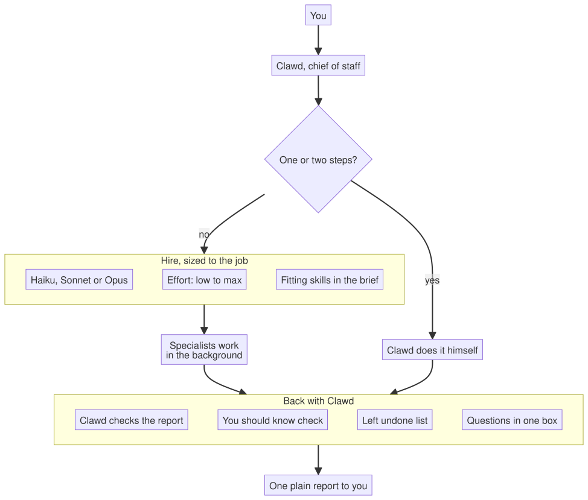
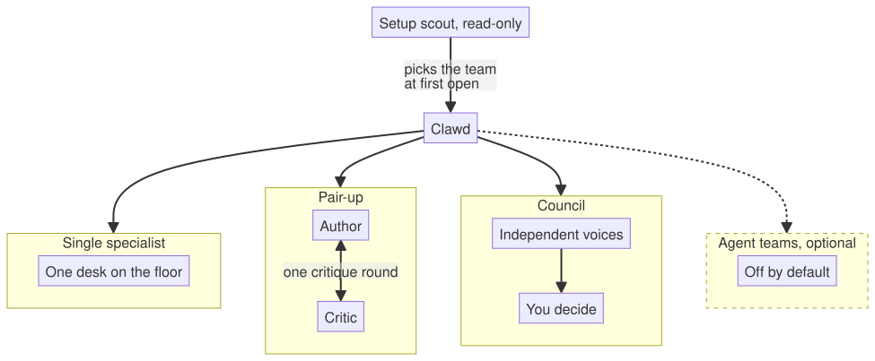
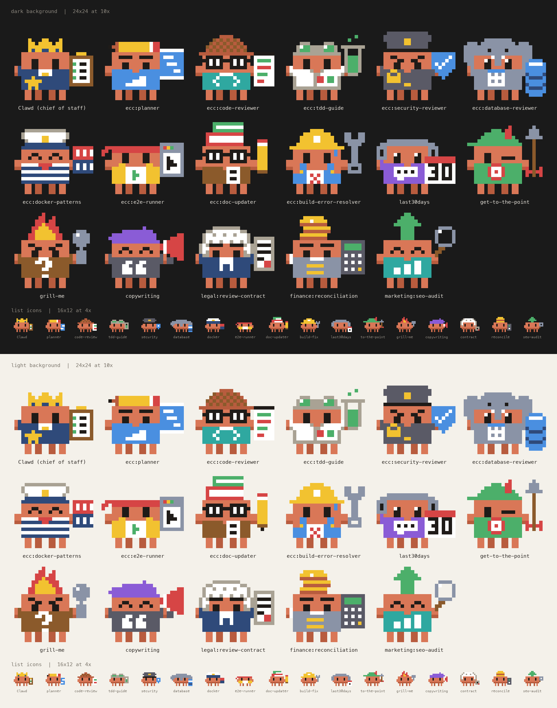
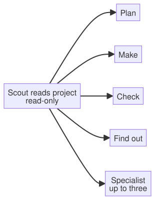

<div align="center">



# Clawd HQ

### A chief of staff for your Claude Code project.

Brief Clawd once. He picks specialists from your installed helpers, runs independent work in the background, and brings back one report. Keep talking while the specialists work.

`free to talk` · `uses your installed helpers` · `right-sized models` · `live office panel`

[What it does](#-what-it-does) · [How it runs](#-how-clawd-runs-the-work) · [The office](#-the-office) · [Setup](#-first-time-setup) · [Privacy](#-privacy)

</div>

---

<!-- SCREENSHOT: the Office tab mid-job, or a short GIF of /office-demo. -->

```bash
claude plugin marketplace add vedant-shah/clawd-hq
claude plugin install clawd-hq@clawd-hq
```

Start a session. The office opens on its own. Type `/office-demo` for a one-minute tour.

Needs Claude Code v2.1.287 or later.

## ✨ What it does

Clawd HQ isn't a new agent runtime. It packages Claude Code's native agents into an opinionated project workflow: delegation by default for larger jobs, model and effort sizing, quiet progress, and a live office panel.

### 1. Stays free to talk

- **Delegates by default.** Clawd hands every job of more than two or three steps to a specialist in the background. Jobs that don't depend on each other run side by side. Ask him anything while three specialists work.
- **Specialists don't stall.** They never stop mid-run for a question. They make their best call, finish the job, and list their assumptions and questions at the end for Clawd.
- **Steer a running specialist.** Uses Claude Code's own agent messaging: Clawd can message any running specialist, and it picks the message up at its next step. Change or add to a brief without restarting the job.
- **One report.** Questions come to you in one box (up to four) at a pause. Quiet chat hides "finished" notices. Failures and questions always show.
- **Plain words.** Clawd talks in plain, short sentences, borrowing a few rules from ASD-STE100 (Simplified Technical English).

Free to talk is the aim, not a promise. Short direct jobs (a single command, a line or two) Clawd does himself, and then you wait.

### 2. Right team, right size

- **Uses what you already have.** Setup picks your team from the agents and skills you have installed. Each brief names the installed skills that fit the job. Nothing new to download.
- **Hires, doesn't guess.** Before a new kind of job, Clawd searches every installed agent and skill and picks the best fit, saying why when none fits. An off-team skill can be hired for one job as a contractor; hire it twice and he offers to make it staff. Every hire is named. A generalist is the last resort. When nothing installed fits, he says so and points you to the `find-skills` skill to search the public skill registry. Installing is your call; Clawd never downloads anything.
- **Right-sized hires.** Each job gets the smallest model and effort that can do it well, from Haiku to Opus. Skills are attached only when they add knowledge, not process: at most two, and none for a one-file edit or a job on the smallest model.
- **Pair-ups.** Two or more specialists check each other on risky work.
- **Lay off unused helpers.** Helpers outside the team are laid off on their own, which keeps Clawd's choices short. Search brings any back.
- **Edit Clawd.** Change his rules or voice in plain words, from Settings. A short set of core rules is locked in code, so no edit can remove them. One click on Reset goes back to the built-in text.

### 3. Checks, and keeps you oriented

- **You should know.** Our own check on finished work: Haiku reads the specialist's full record against its report, and speaks up only when something matters. It backs off if you ignore it. It stands in for Claude Code's built-in You should know while it's on, so you aren't told twice. Every card has **Ask Clawd**.
- **Left undone.** Lists work that was put off, like TODOs and skipped tests. "Do it now" puts it in your prompt box.
- **Recap.** Back from a break? Clawd's card shows where you were and the next step. It asks one short question on the chat Claude Code has already cached.
- **Coffee break.** Compacts a long chat at a calm moment, never mid-build.
- **Lasting rules, on your say-so.** When you state a rule for later work ("always", "from now on"), Clawd offers it on a card. One press adds that exact line to the project's CLAUDE.md, which every specialist already reads. An answer in the question box settles only the job at hand.
- **Artifact Desk.** Every page Claude publishes on claude.ai, one click away.

Every check can be turned off in Settings. Nothing is ever sent for you. Buttons fill your prompt box; the one exception is "Add to CLAUDE.md", which writes the line you see.

## 🔁 What changes

Claude Code already runs subagents in the background, with a model and effort per agent ([docs](https://code.claude.com/docs/en/sub-agents)). Clawd HQ sets that up for you and adds the workflow around it.

| | Plain Claude Code | With Clawd HQ |
| --- | --- | --- |
| Delegation | Claude decides case by case | Larger jobs go to specialists by default |
| Choosing models | You or each agent file set them | Clawd sizes model and effort per job |
| Questions | Come as they arise | Up to four in one box, at a pause |
| Progress | Raw tool rows in the chat | Plain-words steps in a live office panel |

- Clawd does one-step jobs himself. Anything bigger goes to a specialist.
- Lasting rules live in your CLAUDE.md, so you aren't asked twice.

## 🧭 How Clawd runs the work

Clawd HQ follows the "elephants and goldfish" idea from Google ([paper](https://research.google/pubs/elephants-goldfish-and-the-new-golden-age-of-software-engineering/)):

- **The elephant is Clawd.** One long conversation with you holds the project's memory and decisions. He writes no code himself.
- **The goldfish are the specialists.** Each starts fresh and knows only its brief, so it has none of the chat's blind spots.
- **Fresh eyes check the plan.** For risky work, a fresh Reviewer first restates the plan in its own words. A part it can't restate is unclear and gets fixed before anyone builds.

**How a request flows**

<p align="center"></p>

- You only talk to Clawd. He does one- or two-step jobs himself and hires for the rest.
- Each hire gets a model and effort sized to the job, and a brief that names the skills that fit.
- Work comes back to Clawd first. He checks it, a small model looks for gaps, and questions wait for one box.
- You get one plain report. Quiet chat hides the noise in between.

**The ways Clawd can staff a job**

<p align="center"></p>

- **Single specialist.** The usual case. One helper works in the background at its own desk.
- **Pair-up.** For risky or wide work. Named specialists, such as an author and a critic, message each other directly (helpers that lack Claude Code's messaging tool go through Clawd). After one round of critique, each reports to Clawd. The office shows them as one card.
- **Council.** For a hard choice that is hard to undo. Press "Hold a council" on Clawd's card (it fills your prompt box) or type `/council <question>`: four fresh voices answer once, without seeing each other, and Clawd sums up without being one of them. You decide. The office shows it as one Council card.
- **Agent teams.** Only when Claude Code's experimental agent-teams feature is turned on. It is off by default.

## 🏢 The office

Type `/office` to open it. The Office tab looks like this:

```
╭──────────────────────────────────────────────────╮
│ [Clawd]  Clawd Chief of Staff            ● Free  │
│          Opus 5.5 · High                         │
│          ╭─────────────────────────────────────╮ │
│          │ Desks are busy. I'm all ears.       │ │
│          ╰─────────────────────────────────────╯ │
╰──────────────────────────────────────────────────╯

YOU SHOULD KNOW
╭──────────────────────────────────────────────────╮
│ HEADS UP · Builder                               │
│ The report says all tests pass, but one test     │
│ file was skipped.                                │
│ [Learn more]  Ask Clawd  Dismiss                 │
╰──────────────────────────────────────────────────╯

AT WORK · 3
╭──────────────────────────────────────────────────╮
│ [pic]  Builder  Add the export button            │
│        Writing the test for the empty case.      │
│        Sonnet 5.5 · medium · 4m · 38K tokens     │
│        ▓▓▓░░ Step 3 of 5                         │
╰──────────────────────────────────────────────────╯
╭──────────────────────────────────────────────────╮
│ [pic][pic]  Planner & Reviewer  Plan the move    │
│             Working · 6m · 52K tokens            │
╰──────────────────────────────────────────────────╯

                        [Usage ▾] 42% · 18% · 9%
```

- **Clawd's card.** His status, with a green, amber or red dot. The chat's model and effort. He stays free while specialists work, and falls asleep when the office is quiet.
- **At work.** One card per specialist: its own words, model, time, tokens and a progress bar.
- **Pair-up.** Specialists hired together share one card.
- **Council.** The voices of a council share one card, with each voice's status. When all have finished, it shows the first line of each report.
- **Usage.** Context, session limit and weekly limit. Amber at 70%, red at 90%.

The other tabs:

- **People.** Your team, with what each helper does and how many tokens it has used. Helpers outside the team, including ones you install later, are laid off on their own; search finds them again.
- **Settings.** The switches, the work finished this session, and Clawd's rules and voice.

Every helper gets its own pixel Clawd, drawn for what it does:

<p align="center">
  
</p>

<!-- SCREENSHOT: a cropped strip of the avatars, if the full sheet is too tall. -->

## 🆚 How it's different

- **Usage panels show numbers.** This one shows who is doing what, and has the numbers too.
- **Multi-session tools make you run each session.** Here the chat hands out the work.
- **Workflow kits make you drive them with commands.** Clawd picks the helper and model himself.
- **Big catalogs give you hundreds of agents.** Setup picks a small team from what you already use. Clawd searches everything installed before a new kind of job, so the team is never a ceiling.
- **One office per project.** In other offices, every hire starts with picking a repo. Here the office is the project, so you never pick one.
- **It needs nothing else.** It ships its own Planner, Builder, Reviewer and Researcher.

## 🚀 First-time setup

Setup runs on its own the first time. No questions. A card shows what it picked.

<p align="center"></p>

- It reads the project and lists the agents and skills you have installed, and picks the team from that list.
- It counts which helpers you used in past sessions, on this computer.
- An empty Plan, Make, Check or Find out seat gets Clawd HQ's own Planner, Builder, Reviewer or Researcher.

Type `/office-setup` to run it again. Turn off "Automatic setup" in Settings if you'd rather start it yourself.

## ⚙️ Settings

All on by default. Flip them in the Settings tab.

<details>
<summary>What each switch does</summary>

| Switch | When it's off |
| --- | --- |
| Clawd runs the chat | Claude behaves as usual. You keep the panel. |
| Quiet chat | The chat shows every row. |
| Automatic setup | Setup runs only when you type `/office-setup`. |
| Recap on Clawd's card | No recap is made. |
| You should know | Finished work isn't checked. Claude Code's own note works as usual. |
| Left undone check | The model check is skipped. Code markers are still read. |
| Your own voice file | A path to a text file that changes Clawd's tone. Empty by default. |

Clawd's rules also reach scripted runs (`claude -p` and the Agent SDK). Turn off "Clawd runs the chat" if you don't want that.

</details>

## 🔒 Privacy

Most of it runs on your machine. Model calls use your plan.

<details>
<summary>What is sent to which model</summary>

| When | Model | What it sees |
| --- | --- | --- |
| Setup picks a team | Sonnet, read-only | Files in this project it opens (no content search, no secret-named files, nothing outside the folder), plus your helpers' names and use counts. About $0.15 per project on API billing ($0.13 to $0.18 across 11 real projects). |
| Setup fallback | Opus, once | A project summary, the README, your instruction files, helper names and counts |
| Setup writes your workflow | Haiku | Your instruction files |
| Recap | The session's model | One short question on the cached chat |
| You should know | Haiku | The brief, each step, and the report. Long outputs are trimmed. |
| Left undone check | Haiku | Your request and Clawd's final report |
| Coffee break | The session's model | One short question on the cached chat |

Apart from these calls, the plugin opens no network connections and starts no processes.

</details>

<details>
<summary>What is stored, and where</summary>

- **Your Claude Code config folder, never your project:** who you laid off, hire counts, the Artifact Desk list, "You should know" notes, and the Left undone list.
- **Your project's CLAUDE.md:** only the rule lines you add with "Add to CLAUDE.md".
- **Past sessions:** read on this computer. Only helper names and counts are kept.
- **Your copies of Clawd's rules and voice:** in `~/.clawd-hq/`, made only when you edit them.

</details>

## ❓ FAQ

<details>
<summary>Does it cost more?</summary>

Specialists use your plan like any Claude work. Clawd picks the smallest model for each job, so routine work often runs on Haiku. Each extra check is one small call, and each can be turned off.

</details>

<details>
<summary>Will it hide something I need?</summary>

No. Failures, stopped jobs, errors, questions and permission requests always show. Press `ctrl+o` for the full view.

</details>

<details>
<summary>Can I go back to plain Claude?</summary>

Yes. Turn off "Clawd runs the chat". You keep the panel.

</details>

<details>
<summary>Does it work in Cowork or Claude chat?</summary>

The panel is a mod, and mods don't run in Cowork or Chat.

</details>

<details>
<summary>How do I update?</summary>

```bash
claude plugin marketplace update clawd-hq
```

Then run `/reload-plugins` or restart Claude Code. You can turn on auto-update in `/plugin`.

</details>

## Status

Early and still changing. Please open an issue when you hit a rough edge.

## Development

From `plugins/clawd-hq`:

```bash
claude plugin validate .
claude plugin test .
npx -y -p typescript tsc --noEmit -p .
```

Unofficial. Not made by, endorsed by, or affiliated with Anthropic. Clawd is Anthropic's mascot. MIT license, see [LICENSE](LICENSE).
