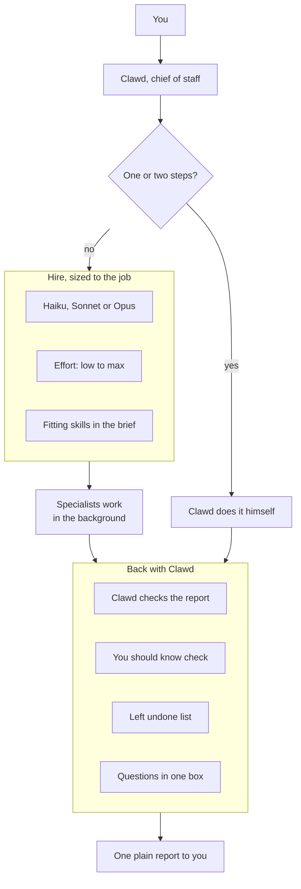
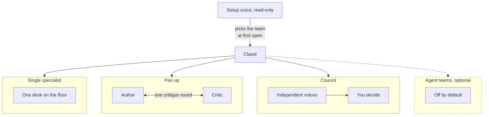
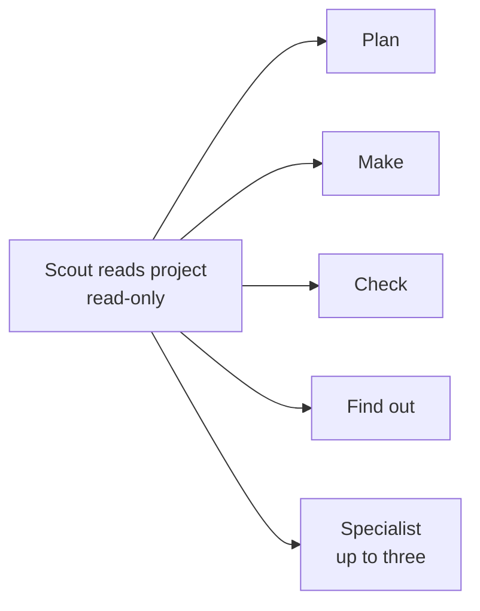

<div align="center">


# Clawd HQ

### A Claude Code plugin that turns Claude into your chief of staff.

Clawd hands your work to specialist agents and runs them in the background, so he is always free to talk to you. You watch them work in a live office panel.

`always free to talk` · `uses your installed helpers` · `right-sized models` · `live office panel`

[Features](#-features) · [How it runs](#-how-clawd-runs-the-work) · [The office](#-the-office) · [Setup](#-first-time-setup) · [Privacy](#-privacy)

</div>

---

<!-- SCREENSHOT: the Office tab mid-job, or a short GIF of /office-demo. -->

```bash
claude plugin marketplace add vedant-shah/clawd-hq
claude plugin install clawd-hq@clawd-hq
```

Start a session. The office opens on its own. Type `/office-demo` for a one-minute tour.

Needs Claude Code v2.1.287 or later.

## ✨ Features

- **Always free to talk.** Clawd hands every job of more than two or three steps to a specialist in the background. Jobs that don't depend on each other run side by side. Ask him anything while three specialists work: he doesn't go heads-down.
- **Uses what you already have.** Setup picks your team from the agents and skills you have installed. Each brief names the installed skills that fit the job. Nothing new to download.
- **Right-sized hires.** Each job gets the smallest model and effort that can do it well, from Haiku to Opus.
- **Recap.** Back from a break? Clawd's card shows where you were and the next step.
- **You should know.** A small model checks each report against what was done. It speaks only when it matters.
- **Left undone.** Lists work that was put off, like TODOs and skipped tests. "Do it now" puts it in your prompt box.
- **Coffee break.** Compacts a long chat at a calm moment, never mid-build.
- **Pair-ups.** Two or more specialists check each other on risky work.
- **Artifact Desk.** Every page Claude publishes on claude.ai, one click away.
- **Lay off unused helpers.** Keeps Clawd's choices short. One tap brings any back.
- **Edit Clawd.** Change his rules or voice in plain words, from Settings.
- **Your decisions stick.** What you answer in Clawd's question box goes into every brief.
<!-- CHANGING: the separate decisions file (.clawd-hq/decisions.md) is being removed. A button will put "Add this rule to the project's CLAUDE.md: <rule>" in your prompt box instead, and you send it yourself. Rewrite this item when that lands. -->

Nothing is ever sent for you. Buttons only fill your prompt box.

## 🔁 What changes

| | Plain Claude Code | With Clawd HQ |
| --- | --- | --- |
| While work runs | You wait for Claude | Clawd is free to talk |
| Who does the work | Claude, in your chat | Specialists, in the background |
| Which model | One model for everything | The smallest model that can do each job |
| Questions | One at a time, any time | Up to four in one box, at a pause |

- Clawd does one-step jobs himself. Anything bigger goes to a specialist.
- Each brief carries your past decisions, so you aren't asked twice.
- Quiet chat hides "finished" notices. Failures and questions always show.

## 🧭 How Clawd runs the work

**How a request flows**



- You only talk to Clawd. He does one- or two-step jobs himself and hires for the rest.
- Each hire gets a model and effort sized to the job, and a brief that names the skills that fit.
- Work comes back to Clawd first. He checks it, a small model looks for gaps, and questions wait for one box.
- You get one plain report. Quiet chat hides the noise in between.

**The ways Clawd can staff a job**



- **Single specialist.** The usual case. One helper works in the background at its own desk.
- **Pair-up.** For risky or wide work. Named specialists, such as an author and a critic, message each other directly. After one round of critique, each reports to Clawd. The office shows them as one card.
- **Council.** For a hard choice that is hard to undo. A few voices answer on their own, and you decide.
- **Agent teams.** Only when Claude Code's experimental agent-teams feature is turned on. It is off by default.

## 🏢 The office

Type `/office` to open it. The Office tab looks like this:

```
╭──────────────────────────────────────────────────╮
│ [Clawd]  Clawd Chief of Staff            ● Free  │
│          Opus 5.5 · High                         │
│          ╭─────────────────────────────────────╮ │
│          │ Desks are busy. I'm all ears.       │ │
│          ╰─────────────────────────────────────╯ │
╰──────────────────────────────────────────────────╯

YOU SHOULD KNOW
╭──────────────────────────────────────────────────╮
│ HEADS UP · Builder                               │
│ The report says all tests pass, but one test     │
│ file was skipped.                                │
│ [Learn more]  Ask Clawd  Dismiss                 │
╰──────────────────────────────────────────────────╯

AT WORK · 3
╭──────────────────────────────────────────────────╮
│ [pic]  Builder  Add the export button            │
│        Writing the test for the empty case.      │
│        Sonnet 5.5 · medium · 4m · 38K tokens     │
│        ▓▓▓░░ Step 3 of 5                         │
╰──────────────────────────────────────────────────╯
╭──────────────────────────────────────────────────╮
│ [pic][pic]  Planner & Reviewer  Plan the move    │
│             Working · 6m · 52K tokens            │
╰──────────────────────────────────────────────────╯

                        [Usage ▾] 42% · 18% · 9%
```

- **Clawd's card.** His status, with a green, amber or red dot. The chat's model and effort. He stays free while specialists work, and falls asleep when the office is quiet.
- **At work.** One card per specialist: its own words, model, time, tokens and a progress bar.
- **Pair-up.** Specialists hired together share one card.
- **Usage.** Context, session limit and weekly limit. Amber at 70%, red at 90%.

The other tabs:
<!-- CHANGING: the Decisions tab is being removed. This list is written for after that change. -->

- **People.** Hire, lay off and search your helpers.
- **Settings.** The switches, the work finished this session, and Clawd's rules and voice.

Every helper gets its own pixel Clawd, drawn for what it does:

<p align="center">
  
</p>

<!-- SCREENSHOT: a cropped strip of the avatars, if the full sheet is too tall. -->

## 🆚 How it's different

- **Usage panels show numbers.** This one shows who is doing what, and has the numbers too.
- **Multi-session tools make you run each session.** Here the chat hands out the work.
- **Workflow kits make you drive them with commands.** Clawd picks the helper and model himself.
- **Big catalogs give you hundreds of agents.** Setup picks a small team from what you already use.
- **It checks the work.** "You should know" and "Left undone" catch what reports leave out.
- **It needs nothing else.** It ships its own Planner, Builder, Reviewer and Researcher.

## 🚀 First-time setup

<!-- CHANGING: setup is becoming silent. It will ask no questions and be on by default, with switches in Settings. Check this section against the code when it lands. -->

Setup runs on its own the first time. No questions. A card shows what it picked.



- It reads the project and lists the agents and skills you have installed, and picks the team from that list.
- It counts which helpers you used in past sessions, on this computer.
- An empty Plan, Make, Check or Find out seat gets Clawd HQ's own Planner, Builder, Reviewer or Researcher.
- It suggests a first job. You send it yourself.

Type `/office-setup` to run it again.

## ⚙️ Settings

All on by default. Flip them in the Settings tab.

<details>
<summary>What each switch does</summary>

| Switch | When it's off |
| --- | --- |
| Clawd runs the chat | Claude behaves as usual. You keep the panel. |
| Quiet chat | The chat shows every row. |
| Recap on Clawd's card | No recap is made. |
| You should know | Finished work isn't checked. Claude Code's own note works as usual. |
| Left undone check | The model check is skipped. Code markers are still read. |
| Your own voice file | A path to a text file that changes Clawd's tone. Empty by default. |

Clawd's rules also reach scripted runs (`claude -p` and the Agent SDK). Turn off "Clawd runs the chat" if you don't want that.

</details>

## 🔒 Privacy

Most of it runs on your machine. Model calls use your plan.

<details>
<summary>What is sent to which model</summary>

| When | Model | What it sees |
| --- | --- | --- |
| Setup picks a team | Sonnet, read-only | Files in this project it opens (no content search, no secret-named files, nothing outside the folder), plus your helpers' names and use counts. About $0.15 per project ($0.13 to $0.18 across 11 real projects). |
| Setup fallback | Opus, once | A project summary, the README, your instruction files, helper names and counts |
| Setup writes your workflow | Haiku | Your instruction files |
| Recap | The session's model | One short question on the cached chat |
| You should know | Haiku | The brief, each step, and the report. Long outputs are trimmed. |
| Left undone check | Haiku | Your request and Clawd's final report |
| Coffee break | The session's model | One short question on the cached chat |

Apart from these calls, the plugin opens no network connections and starts no processes.

</details>

<details>
<summary>What is stored, and where</summary>

- **Your Claude Code config folder, never your project:** who you laid off, hire counts, the Artifact Desk list, "You should know" notes, and the Left undone list.
- **Past sessions:** read on this computer. Only helper names and counts are kept.
- **Your copies of Clawd's rules and voice:** in `~/.clawd-hq/`, made only when you edit them.

</details>

## ❓ FAQ

<details>
<summary>Does it cost more?</summary>

Specialists use your plan like any Claude work. Clawd picks the smallest model for each job, so routine work often runs on Haiku. Each extra check is one small call, and each can be turned off.

</details>

<details>
<summary>Will it hide something I need?</summary>

No. Failures, stopped jobs, errors, questions and permission requests always show. Press `ctrl+o` for the full view.

</details>

<details>
<summary>Can I go back to plain Claude?</summary>

Yes. Turn off "Clawd runs the chat". You keep the panel.

</details>

<details>
<summary>Does it work in Cowork or Claude chat?</summary>

The panel is a mod, and mods don't run in Cowork or Chat.

</details>

<details>
<summary>How do I update?</summary>

```bash
claude plugin marketplace update clawd-hq
```

Then run `/reload-plugins` or restart Claude Code. You can turn on auto-update in `/plugin`.

</details>

## Status

Early and still changing. Please open an issue when you hit a rough edge.

## Development

From `plugins/clawd-hq`:

```bash
claude plugin validate .
claude plugin test .
npx -y -p typescript tsc --noEmit -p .
```

Unofficial. Not made by, endorsed by, or affiliated with Anthropic. Clawd is Anthropic's mascot. MIT license, see [LICENSE](LICENSE).
